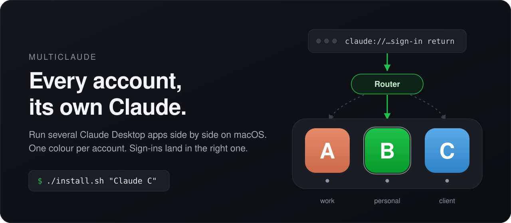

<p align="center">
  
</p>

# MultiClaude

**Plusieurs Claude Desktop ouverts en même temps sur macOS, un compte chacun.** Une couleur par compte,
une tuile par compte dans le Dock, et chaque connexion revient dans l'app qui l'a demandée.
[English](README.md)

Claude Desktop ne tient qu'un compte. Avec deux comptes (pro et perso, celui d'un client, un second
abonnement pour quand le premier atteint sa limite hebdomadaire), il faut se déconnecter puis se
reconnecter, et les sessions Code s'arrêtent avec.

```bash
git clone https://github.com/0xsysone/multi-claude-desktop-mac.git
cd multi-claude-desktop-mac
./install.sh
```

Un **Claude B** vert apparaît dans le Dock. L'ouvrir, se connecter avec l'autre compte. C'est tout.

## Ce que ça apporte

- **Deux, trois, quatre Claude en même temps**, chacun sur son compte, avec ses conversations, ses
  sessions Code et ses réglages.
- **Une couleur par compte** (vert, bleu, violet…) sur la tuile du Dock et dans le sélecteur d'apps.
- **Une seule tuile par compte**, avec le point d'app ouverte.
- **Des connexions qui arrivent au bon endroit.** Se connecter à un compte, ou connecter un serveur MCP
  en OAuth depuis une session Code, passe par le navigateur et revient par un lien `claude://`. Avec
  plusieurs Claude ouverts, macOS le remet à n'importe lequel. MultiClaude le remet à celui qui l'a lancé.
- **Des apps intactes, mises à jour toutes seules.** Chaque compte tourne sur une copie notariée de
  Claude.app. `/Applications/Claude.app` n'est jamais modifié.
- **Local et petit.** Deux scripts et un fichier Swift. Aucun accès réseau, aucun identifiant lu.

## Ajouter un compte

```bash
./install.sh "Claude C"                  # prochaine couleur libre
./install.sh "Claude Pro" --color blue   # green, blue, purple, pink, teal, yellow
```

À faire quand on en a besoin : le routeur de liens découvre les comptes tout seul.

## Au quotidien

```bash
./install.sh --status        # comptes, ce qui tourne, qui reçoit les liens claude://
./uninstall.sh "Claude C"    # retirer un compte (ses données sont gardées ; --purge pour les jeter)
./uninstall.sh --all         # tout retirer
```

`./install.sh` peut être relancé à tout moment, Claude ouvert : il ne l'arrête jamais.

## Un réglage à activer

**Réglages Système › Confidentialité et sécurité › Gestion des apps › Claude Router**

Chaque mise à jour de Claude remplace l'app, donc l'icône colorée. macOS ne laisse une app la remettre
que si elle y est autorisée ici. Sans cela tout fonctionne ; le compte affiche l'icône standard jusqu'au
prochain `./install.sh`.

## À savoir

- **Disque** : chaque compte est une copie complète de Claude.app, environ 650 Mo.
- **Ouverture de session** : le routeur est installé comme agent (≈ 30 Mo, inactif). Pour l'éviter :
  `./install.sh --no-agent` ; on ouvre alors les comptes par Spotlight ou Launchpad.
- **Noms** : « Claude quelque chose » (`Claude B`, `Claude Pro`) ; c'est aussi le nom du dossier de données.
- **Diagnostic** : `./install.sh --status`, puis `~/Library/Logs/MultiClaude.log`.
- **Prérequis** : macOS 13 ou plus, Claude Desktop dans `/Applications`, les Command Line Tools de Xcode.
  Testé sur macOS 26.6 avec Claude Desktop 4.23.

Le fonctionnement détaillé est dans [docs/internals.md](docs/internals.md) (en anglais).

## Indépendant d'Anthropic

MultiClaude est un outil indépendant et non officiel. « Claude » est une marque d'Anthropic. Il s'appuie
sur le comportement actuel de Claude Desktop, qui peut changer à chaque mise à jour. À utiliser avec des
comptes auxquels vous avez droit, dans le respect des conditions d'Anthropic.

Licence [MIT](LICENSE).
