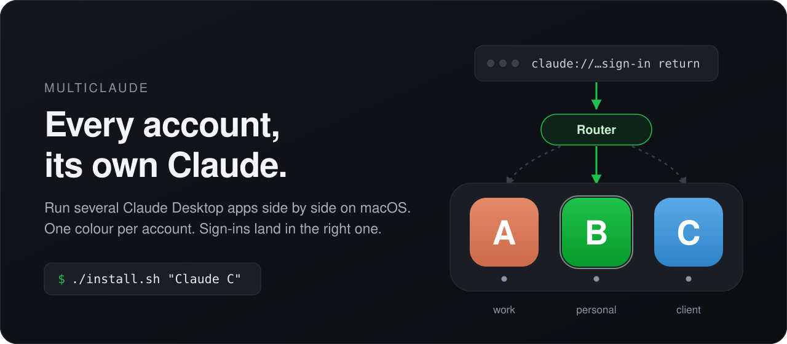

<p align="center">
  
</p>

<p align="center">
  <b>Run several Claude Desktop apps side by side on your Mac — one account each.</b><br>
  One colour per account, one Dock tile each, and every sign-in lands in the app that asked for it.
</p>

<p align="center">
  <a href="https://github.com/0xsysone/multi-claude-desktop-mac/stargazers"></a>
  
  
  <a href="LICENSE"></a>
  <a href="README.fr.md"></a>
</p>

---

Claude Desktop holds one account. If you have two — work and personal, a client's, a second Max plan for
when the first one hits its weekly limit — you sign out and back in, and your Code sessions stop with it.

**MultiClaude gives every account its own Claude, all open at once.** macOS only.

```bash
git clone https://github.com/0xsysone/multi-claude-desktop-mac.git
cd multi-claude-desktop-mac
./install.sh
```

A green **Claude B** appears in your Dock. Open it, sign in with your other account. That's it.

## What you get

- **Two, three, four Claudes at the same time.** Each on its own account, with its own chats, Code
  sessions and settings. Nothing to switch, nothing to sign out of.
- **A colour per account.** Green, blue, purple… on the Dock tile and in the app switcher. You always
  know which Claude you are looking at.
- **One Dock tile per account.** It shows the running dot, and clicking it opens that account. No
  helper icons piling up.
- **Sign-ins that land where they should.** Signing in to an account, or connecting an MCP server with
  OAuth from a Code session, sends you to the browser and back through a `claude://` link. With several
  Claudes open, macOS hands that link to whichever it likes. MultiClaude routes it to the app that
  started it.
- **Untouched apps, automatic updates.** Each account runs a pristine, notarized copy of Claude.app that
  updates itself like the original. `/Applications/Claude.app` is never modified.
- **Local and small.** Two shell scripts and one Swift file. No network access, no credentials read, no
  daemon with privileges.

## Add an account

```bash
./install.sh "Claude C"                  # next free colour
./install.sh "Claude Work" --color blue  # green, blue, purple, pink, teal, yellow
```

Add one whenever you need it: the link router finds accounts on disk by itself.

## Everyday commands

```bash
./install.sh --status        # accounts, what is running, who receives claude:// links
./uninstall.sh "Claude C"    # remove an account (its data is kept; add --purge to trash it)
./uninstall.sh --all         # remove everything MultiClaude installed
```

`./install.sh` is safe to run again at any time, with your Claudes open: it never stops them.

## One setting to turn on

**System Settings › Privacy & Security › App Management › Claude Router**

Every Claude update replaces the app, and with it the coloured icon. macOS only lets an app put it back
if you allow it here. Without it everything still works; the account just shows the standard icon until
you run `./install.sh` again.

## How it works

<table>
<tr><td><b>A copy per account</b></td><td>
<code>~/Library/Application Support/MultiClaude/Claude B/Claude.app</code> is an untouched copy of
Claude.app, started with <code>--user-data-dir</code> so it keeps its own sign-in and sessions in
<code>~/Library/Application Support/Claude B</code>. The colour is a custom Finder icon on the copy, which
sits outside the code signature: macOS still sees a notarized Anthropic app.</td></tr>
<tr><td><b>A link router</b></td><td>
<code>Claude Router</code> is a tiny background app registered for <code>claude://</code> links. An MCP
sign-in goes back to the instance whose Code session started it; an account sign-in is offered to every
instance and only the one that asked takes it; anything else goes to the Claude you used last. Each
decision is written to <code>~/Library/Logs/MultiClaude.log</code>, without the link's secrets.</td></tr>
<tr><td><b>A safety net</b></td><td>
A copy opened without its data folder — a click on its Dock tile, or Claude relaunching itself after
an update — would open your <i>first</i> account's profile. The router, which runs from login, stops it as it
starts and opens the account properly instead.</td></tr>
</table>

Your Claude Code configuration (`~/.claude`: skills, plugins, hooks, settings) is shared by every
account on purpose, so you set things up once. Which account a Code session bills comes from the app
that started it.

More detail, and everything that was verified against the app, in [docs/internals.md](docs/internals.md).

## Good to know

- **Disk.** Each account is a full copy of Claude.app: about 650 MB.
- **Login item.** The router is installed as a login agent (≈ 30 MB of memory, idle). Prefer not to?
  `./install.sh --no-agent` keeps it alive only while an extra account runs and leaves the Dock alone;
  you then open accounts from Spotlight or Launchpad ("Claude B"), never by pinning their running tile.
- **Names.** Accounts are called "Claude something" (`Claude B`, `Claude Work`): the name is also the
  name of the data folder.
- **Troubleshooting.** `./install.sh --status`, then the log. To see where a link would go without
  sending it: `build/multiclaude --explain "claude://…"`.
- **Requirements.** macOS 13 or later, Claude Desktop in `/Applications`, and the Xcode Command Line
  Tools (`xcode-select --install`). Tested on macOS 26.6 with Claude Desktop 4.23.

## Not affiliated with Anthropic

MultiClaude is an independent, unofficial tool. "Claude" is a trademark of Anthropic. It relies on how
Claude Desktop behaves today (a data-folder flag, its `claude://` links, its log format), which can change
with any update: if something breaks, please open an issue. Use it with accounts you are entitled to use,
within Anthropic's terms.

## Star history

<p align="center">
  <a href="https://star-history.com/#0xsysone/multi-claude-desktop-mac&Date">
    
  </a>
</p>

If MultiClaude saves you a sign-out, a ⭐ helps others find it.

## License

[MIT](LICENSE)
